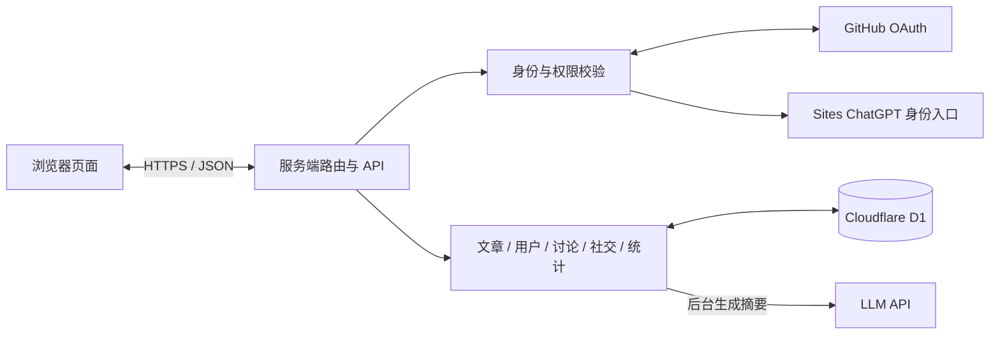

# 知码 · 一个 Vibe Coding 开发者社区项目

**知码（Zhima）是一个通过 Vibe Coding 方式构建并持续迭代的全栈技术社区项目。** 开发者用自然语言提出需求、体验反馈和调整方向，与 Codex 协作完成界面、业务逻辑、数据库和网站发布。

项目面向技术分享与交流，支持 Markdown 创作、AI 摘要、评论讨论、关注私信，以及个人创作数据分析。

在线访问：https://devnote.surecabin2.chatgpt.site

## Vibe Coding 实践

这个项目从“做一个类似掘金的博客网站”开始，通过对话逐步扩展：先完成内容展示与发布，再加入 GitHub 登录、个人资料、文章管理、搜索、Markdown 编辑器、数据中心和社区互动，并根据实际使用反馈调整页面与功能。

- **人来确定需求与取舍**：描述想要的体验，检查效果，决定保留、修改或撤销功能。
- **AI 协助实现与验证**：Codex 结合项目代码完成页面、接口、数据模型和问题修复，并执行相应构建与检查。
- **小步迭代、及时体验**：把自然语言需求转化为可运行的网站，再通过使用反馈推进下一轮改进。

仓库展示的是这次人机协作的项目成果。AI 辅助开发的代码同样需要审查、测试和持续维护；当前实现边界见文末。

## 功能

- **内容浏览**：分类、排序、分页，文章详情、目录、代码复制、点赞与收藏。
- **搜索**：搜索标题、正文、作者、用户 ID、分类与标签；支持 `@用户`、`user:ID`、`#标签`、`tag:标签`。
- **文章创作**：Markdown 源码与预览双栏展示、文档导入、自定义标签，记录上传和更新时间。
- **AI 总结**：发布和更新后异步生成摘要，显示在标题下方；作者可重试失败的任务。
- **用户系统**：ChatGPT 与 GitHub 登录；个人资料包含用户名、职业、职位、公司、简介和可选择公开的联系邮箱。
- **个人管理**：管理自己的文章、收藏和回收站，支持恢复与彻底删除。
- **社区互动**：作者主页、关注、私信、评论和回复；新粉丝、文章评论和回复触发站内通知。
- **数据中心**：文章指标、粉丝增减、近 7/30/90 天趋势、周期比较与文章发布活动日历。

## 架构与技术

同一个应用提供页面和 API，由 Cloudflare Workers 运行，Cloudflare D1 保存业务数据，Sites 管理线上发布。



| 层次 | 实现 |
| --- | --- |
| 页面 | HTML、CSS、JavaScript；多数页面通过路由返回完整 HTML |
| 框架与构建 | Vinext、Next.js 风格路由、Vite、TypeScript |
| 运行环境 | Cloudflare Workers |
| 数据库 | Cloudflare D1（SQLite） |
| 数据结构 | Drizzle Schema、SQL 迁移；业务接口主要使用参数化 SQL |
| Markdown | marked 解析、sanitize-html 清理 HTML |
| 登录 | GitHub OAuth（state、PKCE、服务端会话）、Sites ChatGPT 登录 |
| AI | 服务端调用兼容 Chat Completions 格式的接口 |
| 消息刷新 | 浏览器轮询；私信约 10 秒、顶部未读状态约 20 秒 |

### 数据如何流动

1. **登录**：外部身份经过统一 `getUser()` 关联 `users` 资料。GitHub 会话使用 HttpOnly Cookie，数据库保存令牌哈希和过期时间。
2. **发文**：编辑器提交标题、正文和标签 → 服务端校验并保存 → 返回文章 ID → 后台调用模型 → 将摘要写回对应内容版本。旧任务不能覆盖新版本摘要。
3. **互动**：点赞、收藏、阅读与关注改变业务状态，同时更新每日指标，数据中心聚合这些记录。
4. **讨论**：评论与通知在同一数据库事务中保存；`parent_id` 表示所属主评论，`reply_to_id` 表示具体回复对象。提交 ID 用于避免网络重试造成重复评论。
5. **通知和私信**：只向当前登录用户返回其有权查看的数据，通过轮询获取更新；通知链接可定位到具体评论。

核心表包括 `users`、`posts`、`likes`、`bookmarks`、`views`、`follows`、`messages`、`comments`、`notifications`、`article_daily` 和 `follower_daily`。用户 ID 与文章 ID 连接各模块。

## 本地运行

### 环境要求

- Node.js >= 22.13.0
- npm、Git
- Windows、macOS 或 Linux

### 安装与配置

```sh
git clone https://github.com/Bcpm-coder/zhima.git
cd zhima
npm run install:ci
cp .env.example .env.local
```

Windows 可手动复制 `.env.example` 为 `.env.local`。填写需要启用的配置：

| 变量 | 用途 |
| --- | --- |
| `GITHUB_CLIENT_ID` | GitHub OAuth App Client ID |
| `GITHUB_CLIENT_SECRET` | GitHub OAuth App Client Secret |
| `LLM_API_URL` | 完整 HTTPS Chat Completions 接口地址 |
| `LLM_API_KEY` | 模型 API 密钥 |
| `LLM_MODEL` | 模型名称 |

GitHub OAuth 回调地址为 `<站点 origin>/auth/github/callback`，例如 `http://127.0.0.1:5173/auth/github/callback`。不同环境需要使用匹配的 OAuth App 配置。未配置完整的 LLM 参数时，不会启动摘要生成。

`.env.local` 仅用于本地环境；线上配置应通过 Sites 的运行时环境变量管理设置。不要提交真实密钥。

### 初始化本地数据库

先构建，生成 Wrangler 配置：

```sh
npm run build
```

按照 `drizzle/meta/_journal.json` 中的顺序，对全新本地数据库执行 `drizzle/` 下各个 SQL 文件。每次执行一项，例如：

```sh
node --import ./scripts/sites-env.mjs ./node_modules/wrangler/bin/wrangler.js d1 execute DB --local --config dist/server/wrangler.json --persist-to .wrangler/state --file drizzle/0000_exotic_chamber.sql
```

将 `--file` 替换为后续迁移文件，直到最新迁移。此方式不自动记录已执行的迁移，不要重复执行已应用的文件。命令中的 `--local` 表示只修改本地数据库。

### 启动

```sh
npm run dev
```

默认开发地址为 `http://127.0.0.1:5173`，以终端输出为准。开发环境支持 loopback ChatGPT 模拟登录：访问 `/signin-with-chatgpt?return_to=/`；该模拟入口不会包含在生产构建中。

预览构建后的 Worker：

```sh
npm run build
npm start
```

`npm start` 默认在本地 8787 端口运行，使用同一份 `.wrangler/state` 数据，不模拟登录，也不会部署网站。

## 项目结构

```text
app/
  route.ts                 首页
  article/                 文章详情
  write/                   Markdown 编辑器
  me/                      个人资料、文章管理、数据中心
  user/                    公开作者主页
  search/                  搜索结果页
  messages/                私信
  notifications/           站内通知
  api/                     各业务 API
  auth/                    GitHub OAuth 路由
  auth.ts                  统一身份入口
  seeds.json               示例文章
lib/
  article-*.ts             文章目录、输入校验、状态和摘要
  discussion.ts            评论与通知联动
  social.ts                社交模块公共逻辑
  analytics.ts             指标记录与活动统计
  markdown.ts              Markdown 渲染与清理
  github-oauth.ts          OAuth 工具
  search.ts                搜索语法
db/                       数据模型与数据库入口
drizzle/                  SQL 迁移与元数据
tests/                    自动化测试
build/                    Sites Worker 与构建集成
scripts/                  开发、安装与构建脚本
.openai/hosting.json       Sites 项目标识与存储绑定
```

部分页面的 HTML/CSS/客户端脚本保存在路由文件的字符串中；修改时注意保持字符串编码和路由导出完整。

## 常用命令与测试

```sh
npm run build              # 构建
npm run dev                # 开发服务器
npm start                  # 本地预览构建后的 Worker
npm run db:generate        # 修改 Schema 后生成迁移
node --test tests/*.test.mjs
```

`tests/discussion.integration.py` 是评论与通知的集成测试，使用本地测试身份并写入测试数据；只应针对一次性本地数据库运行。其他测试的前置条件以对应文件为准。

## 部署

当前线上站点由 Sites 发布。`.openai/hosting.json` 保留原站点的项目 ID，声明 D1 绑定 `DB`，未启用 R2。GitHub 仓库用于保存源码，推送 GitHub 不会自动更新线上站点。

- 更新现有站点：通过 Sites 工作流构建、同步源码、保存版本并发布。
- 创建自己的站点：注册新的 Sites 项目并更新项目标识，配置自己的数据库、OAuth App 和运行时密钥。
- 自行部署到 Cloudflare：需要另外配置真实 D1 资源、迁移、生产密钥和身份入口；当前生成的本地 Wrangler 配置包含占位数据库 ID，不能直接当作生产配置使用。

ChatGPT 登录依赖 Sites 的受信身份入口；自行托管时不能直接信任公网客户端传来的身份请求头。

## 当前实现边界

- Markdown 导入保存的是正文文本和文件名，没有将原文件保存到对象存储。
- 示例文章、作者与数据库内容合并展示；示例热度不代表真实访问量。
- 阅读指标是访问计数，不是去重后的独立读者数。
- 搜索使用 SQL 文本匹配，尚未接入全文索引或向量检索。
- GitHub 与 ChatGPT 身份没有自动账号合并功能。
- AI 摘要使用响应后的后台任务，尚未引入持久化任务队列。
- 消息采用轮询，尚未使用 WebSocket。
